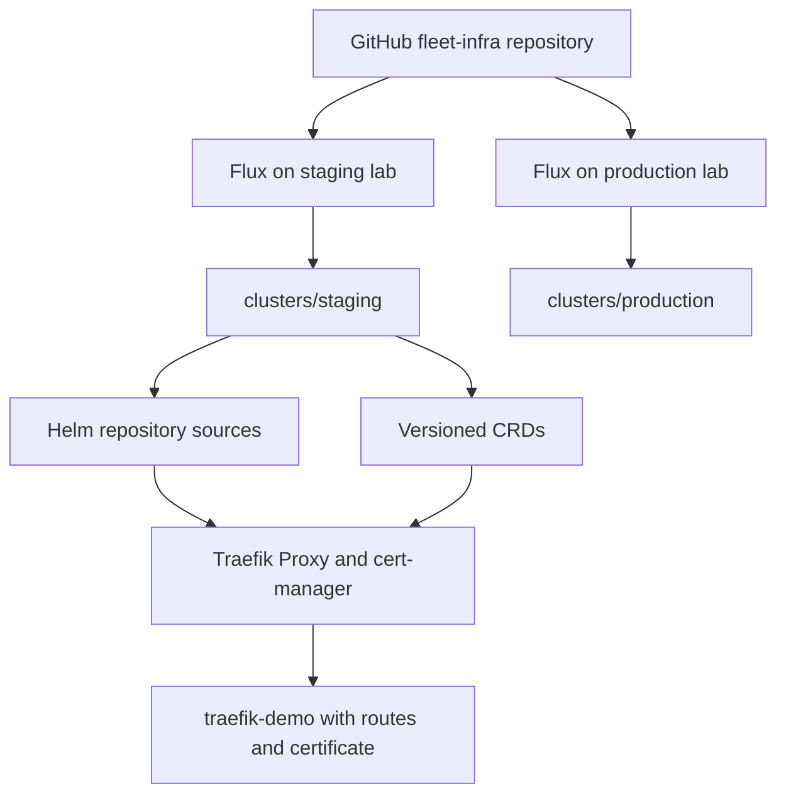
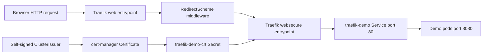

# Architecture and Implementation Choices

## Configuration Flow

Production follows the same dependency graph with production paths and values.
Both clusters use their own Flux controllers and independently reconcile the same
Git repository. The repository does not create either cluster.

## Request and Certificate Flow

The HTTP route references middleware in `traefik-system`, while the routes,
Service, pods, Certificate, and TLS Secret live in `traefik-demo`. Cross-namespace
middleware support is explicitly enabled. Cert-manager, not Traefik's internal
ACME store, owns certificate issuance and renewal.

## Tools and Components

| Component | How it is used |
| --- | --- |
| Git / GitHub | Reviewed desired state, history, separate environment paths |
| Flux source-controller | Fetches Git and Helm repositories and chart artifacts |
| Flux kustomize-controller | Builds manifests, applies them, enforces dependencies and pruning |
| Flux helm-controller | Reconciles the HelmRelease resources into chart installations |
| Kustomize | Shared bases, environment patches, generated ConfigMaps, custom name references |
| Helm | Packages Traefik and cert-manager; versions are pinned in overlays |
| Traefik Proxy | HTTP/HTTPS entrypoints, IngressRoutes, redirect middleware, Service routing |
| cert-manager | Self-signed issuer, Certificate reconciliation, TLS Secret creation |
| monachus/traefik-demo | Course sample workload; icon color varies by environment |
| kubectl | Local Kustomize builds and explicit later cluster diagnostics |
| Bash / Ruby YAML | Local validator and cross-resource consistency checks, not runtime dependencies |

No new application framework or library is introduced; the course deploys an
existing container image. Image automation, CI builds, monitoring, and secret
encryption are not implemented by these lessons.

## Why These Choices Matter

- Shared bases avoid copying common resources between environments.
- Separate CRDs allow custom resource validation before infrastructure or apps apply.
- `dependsOn` enforces the intended reconciliation sequence. Infrastructure also
  waits for health here, reducing the course's cert-manager webhook startup race.
- Generated ConfigMap hashes identify configuration changes. Custom name references
  teach Kustomize to update the HelmRelease's ConfigMap/Secret references.
- Production's fixed chart version is distinct from staging. Both are fixed here
  for a repeatable historical lab, rather than resolving to modern major releases.
- Each environment owns its own certificate Secret. No certificate or private key
  is copied between clusters or stored in Git.
- `replicas` is intentionally absent so the scaling exercise remains unmanaged by Git.
- Pruning removes tracked resources that disappear from desired state. Treat CRD
  removal and namespace removal as potentially destructive changes.

## Learning-Lab Boundaries

The production directory demonstrates a promotion workflow, not a secure production
baseline. These versions are historical, certificates are self-signed, the demo
image is mutable, and cross-namespace/ExternalName support broadens trust. There
are no app resource limits, NetworkPolicies, Pod security settings, durable-data
backups, or high-availability guarantees. Review these separately before adapting
the pattern to a real platform.